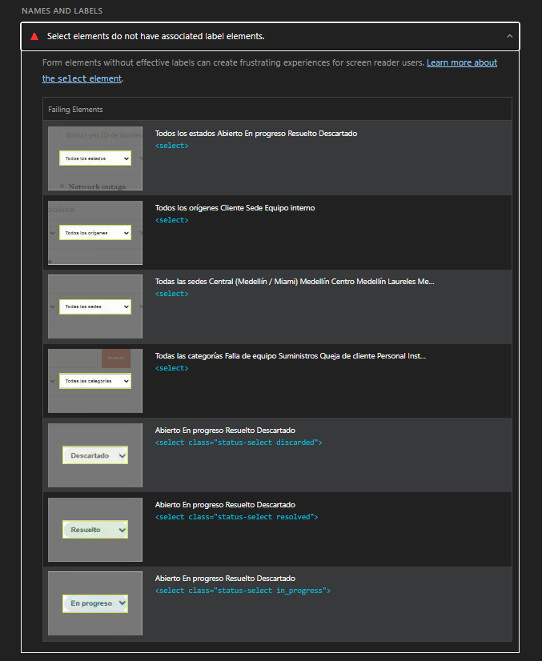
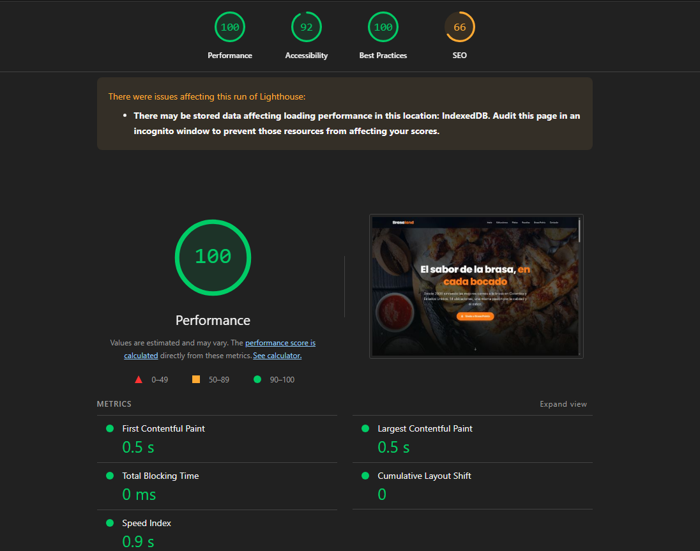
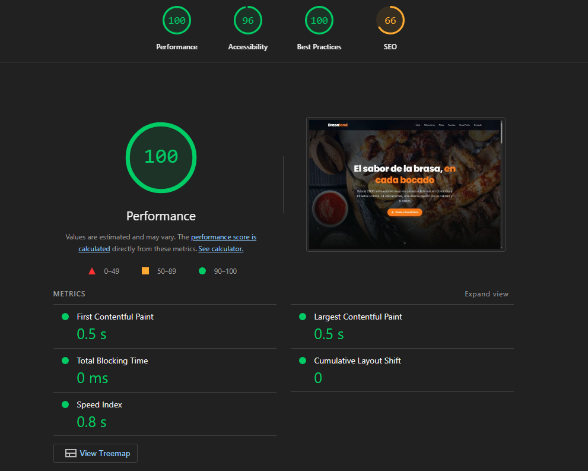
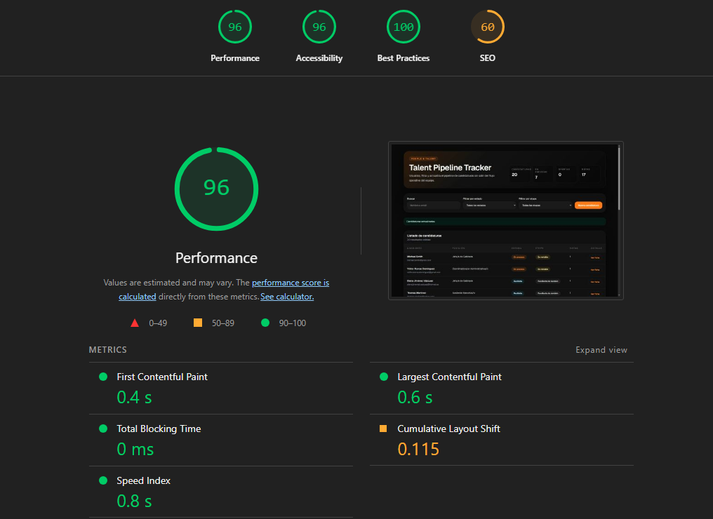
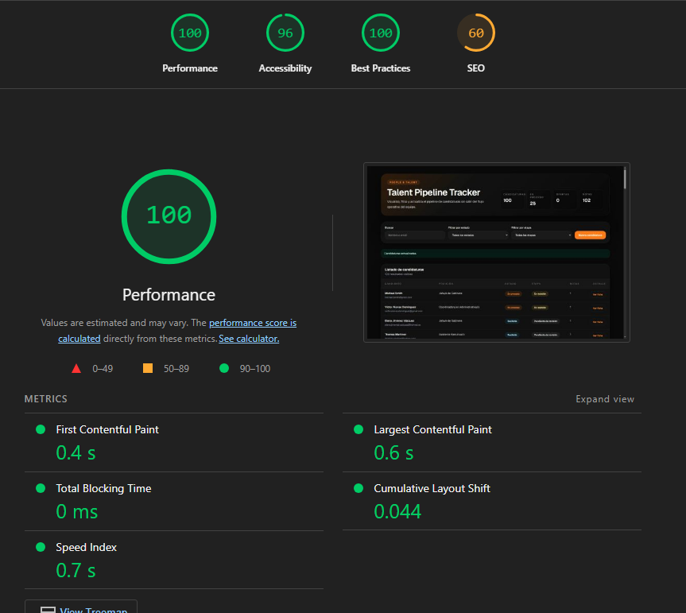
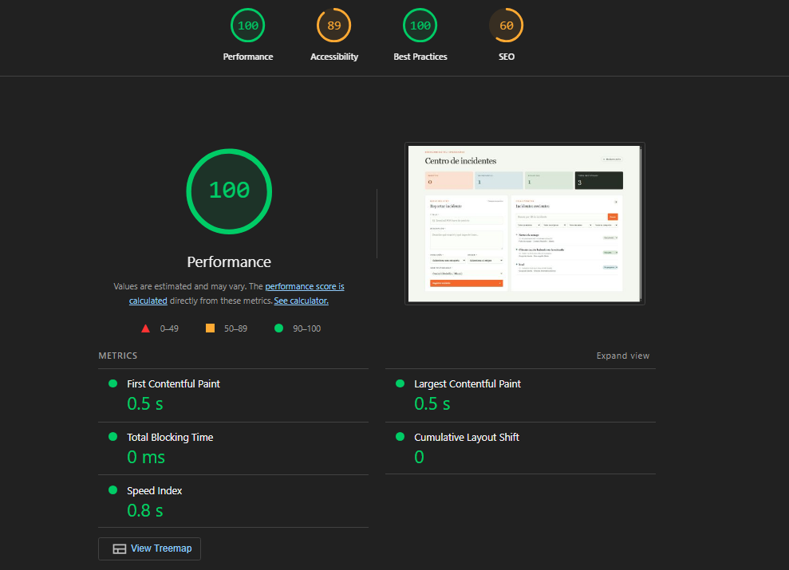
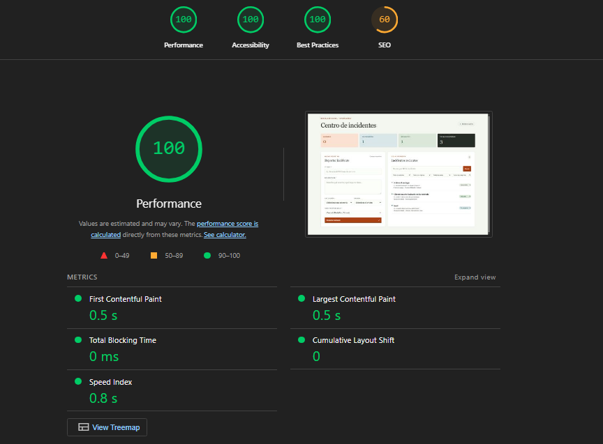

# Informe de mejoras de rendimiento

## Índice
- website — Inicio: Accessibility +4; Performance sin cambios; SEO sin cambios.
- talent-pipeline-tracker — Inicio: Performance +4; CLS mejoró; SEO sin cambios.
- administrar_incidentes — Inicio: Accessibility +11; Performance sin cambios; SEO sin cambios.
- suppliers_tinydb — Inicio: Accessibility +6; Performance +1; SEO sin cambios.

---

## website — Inicio (`https://fuzzy-space-computing-machine-5g4qpxv57495cv6vx-3000.app.github.dev/`)

Condiciones: escritorio; build de producción servido con `next start`; página pública sin login. El usuario repitió la medición en incógnito y los resultados no cambiaron.

### 1. Correcciones aplicadas

- **Qué se cambió:** el componente `StarRating` ahora usa `role="img"` junto con el nombre accesible existente en [HomePage.tsx](../uis/website/components/home/HomePage.tsx#L125).
  - **Causa que resuelve:** el `aria-label` estaba en un `
` sin un rol que admitiese nombre accesible, señalado por Lighthouse.
  - **Métrica objetivo:** Accessibility.
  - **Impacto observado:** la puntuación subió de 92 a 96 (+4). La mejora coincide con la corrección de los elementos señalados.

- **Qué se cambió:** se extrajo `SiteNavigationLinks` para compartir el renderizado de enlaces de escritorio y móvil en [SiteNavigationLinks.tsx](../uis/website/components/SiteNavigationLinks.tsx) y [SiteHeader.tsx](../uis/website/components/SiteHeader.tsx).
  - **Causa que resuelve:** duplicación de marcado para la misma lista de navegación.
  - **Métrica objetivo:** mantenibilidad; no se esperaba un cambio directo en las puntuaciones.
  - **Impacto observado:** sin cambio atribuible en las métricas recibidas; roles, estado actual y cierre del menú móvil se conservaron.

- **Qué se cambió:** se extrajo `BrasaPointsCTA`, usado por las dos llamadas a la acción de la portada, en [BrasaPointsCTA.tsx](../uis/website/components/home/BrasaPointsCTA.tsx) y [HomePage.tsx](../uis/website/components/home/HomePage.tsx).
  - **Causa que resuelve:** repetición del destino y del patrón visual de las llamadas a Brasa Points.
  - **Métrica objetivo:** mantenibilidad; no se esperaba un cambio directo en las puntuaciones.
  - **Impacto observado:** sin cambio de rendimiento atribuible; se preservaron variante, texto, icono y nombre accesible.

### 2. Comparativa antes / después
| Categoría / métrica | Antes | Después | Diferencia |
|---|---:|---:|---:|
| Performance | 100 | 100 | 0 |
| Accessibility | 92 | 96 | +4 |
| Best Practices | 100 | 100 | 0 |
| SEO | 66 | 66 | 0 |
| TTFB | No disponible | No disponible | No evaluable |
| FCP | 0,5 s | 0,5 s | 0 |
| LCP | 0,5 s | 0,5 s | 0 |
| CLS | 0 | 0 | 0 |
| TBT | 0 ms | 0 ms | 0 |
| INP | No disponible | No disponible | No evaluable |
| Speed Index | 0,9 s | 0,8 s | −0,1 s |

Capturas: antes  — después 

### 3. Refactorizaciones realizadas
- `SiteNavigationLinks` concentra los enlaces de navegación de escritorio y móvil. Se conservaron sus roles ARIA, `aria-current` y el cierre al seleccionar una opción en móvil.
- `BrasaPointsCTA` concentra los dos CTA conservando sus diferencias de estilo, texto e icono.
- `npx tsc --noEmit` y `npm run build` terminaron correctamente. ESLint pasó para los componentes extraídos; ESLint de `HomePage.tsx` aún reporta dos errores `react/no-unescaped-entities` en texto de reseñas, no relacionados con estos cambios. La aplicación no tiene un script de pruebas.

### 4. Valoración
- **Mayor impacto:** la corrección del nombre accesible de la calificación, que coincide con la subida de Accessibility de 4 puntos.
- **Sin mejora:** Performance se mantuvo en 100 y FCP, LCP, TBT y CLS no cambiaron. Los refactors fueron de mantenibilidad, no optimizaciones de rendimiento.
- **Speed Index:** bajó 0,1 s (0,9 a 0,8 s). Al ser una diferencia pequeña y sin cambios de Performance, puede estar dentro de la variabilidad de Lighthouse; no la atribuimos a una corrección concreta.
- **SEO:** permaneció en 66. Lighthouse sigue mostrando `X-Robots-Tag: noindex, nofollow` para el host `app.github.dev`, pese a que la metadata de Next.js permite indexación. No se modificó el código de la aplicación porque no controla de forma demostrable ese header externo. Comprobar la URL pública canónica y retirar el header en el servidor/CDN si también se envía allí.
- **Imágenes:** la oportunidad estimada pasó de 259 KiB a 267,3 KiB; es una estimación de ahorro, no una mejora real de transferencia. El detalle de la segunda captura identifica el hero servido con 605 KiB (ahorro estimado de 238,2 KiB; compresión adicional estimada de 200,2 KiB y tamaño responsive de 56,8 KiB) y la imagen de historia con 44,2 KiB (ahorro de 29,1 KiB). No se modificaron imágenes en este ciclo; estos detalles justifican evaluar optimización específica en una iteración posterior y volver a medir.
- **Próximos pasos:** medir la URL pública canónica para resolver el diagnóstico de indexación; evaluar compresión y dimensiones responsive para las imágenes identificadas y hacer otra medición de producción. No añadir preconnects: el diagnóstico no encontró orígenes candidatos.

---

## talent-pipeline-tracker — Inicio (`https://fuzzy-space-computing-machine-5g4qpxv57495cv6vx-3001.app.github.dev/`)

Condiciones: escritorio; build de producción servido con `next start -p 3001`; sin login; API pública. Las capturas corresponden al mismo setup indicado por el usuario.

### 1. Correcciones aplicadas

- **Qué se cambió:** el dashboard muestra filas skeleton mientras espera los datos, reservando espacio para el listado; `CandidateProvider` es ahora el único dueño del fetch inicial.
  - **Causa que resuelve:** inserción tardía de filas y duplicación potencial de la solicitud inicial.
  - **Métrica objetivo:** CLS, carga de red y actualizaciones de estado.
  - **Impacto observado:** CLS bajó de 0,115 a 0,044 (−0,071; aproximadamente 62% menor). No se puede aislar cuánto aportó cada cambio individual.

- **Qué se cambió:** se extrajo `DashboardShell` para el marco exterior usado por el fallback y el dashboard.
  - **Causa que resuelve:** duplicación de layout.
  - **Métrica objetivo:** mantenibilidad, sin expectativa de mejora Lighthouse directa.
  - **Impacto observado:** sin efecto de rendimiento atribuible por sí solo.

### 2. Comparativa antes / después
| Categoría / métrica | Antes | Después | Diferencia |
|---|---:|---:|---:|
| Performance | 96 | 100 | +4 |
| Accessibility | 96 | 96 | 0 |
| Best Practices | 100 | 100 | 0 |
| SEO | 60 | 60 | 0 |
| TTFB | No disponible | No disponible | No evaluable |
| FCP | 0,4 s | 0,4 s | 0 |
| LCP | 0,6 s | 0,6 s | 0 |
| CLS | 0,115 | 0,044 | −0,071 |
| TBT | 0 ms | 0 ms | 0 |
| INP | No disponible | No disponible | No evaluable |
| Speed Index | 0,8 s | 0,7 s | −0,1 s |

Capturas: antes  — después 

### 3. Refactorizaciones realizadas
- `DashboardShell` unifica el marco exterior del fallback y el dashboard.
- `CandidateProvider` centraliza la carga inicial; el dashboard consume el estado y los candidatos.
- `npm run lint`, `npx tsc --noEmit` y `npm run build` finalizaron correctamente. No se ejecutó Lighthouse desde el entorno de desarrollo.

### 4. Valoración
- **Mayor impacto:** reservar espacio para la tabla durante la carga; CLS bajó 0,071 y Performance subió 4 puntos. La contribución individual de retirar el fetch duplicado no puede separarse con esta comparación.
- **Sin cambio:** FCP, LCP, TBT, Accessibility y Best Practices se mantuvieron. El CSS sigue marcado como render-blocking, pero Lighthouse reporta 0 ms de duración y una transferencia similar (7,2 KiB antes, 7,3 KiB después); no se justifica otra corrección por este dato.
- **Speed Index:** mejoró 0,1 s (0,8 a 0,7 s); por ser una diferencia pequeña, puede incluir variabilidad de Lighthouse.
- **JavaScript:** la estimación de JavaScript no utilizado subió de 22,6 KiB a 43,2 KiB; la transferencia de los recursos listados pasó de 44,1 KiB a 110,1 KiB. Lighthouse indica que este diagnóstico no afecta directamente a la puntuación, pero el aumento merece revisar los chunks en otra iteración. No se atribuye una causa sin mapa de bundles.
- **SEO:** sigue en 60 por `X-Robots-Tag: noindex, nofollow` en el host preview. Al ser una herramienta interna, no se cambió la directiva de indexación.
- **Próximos pasos:** investigar el incremento de JavaScript y el CLS residual de 0,044 si se busca otra mejora. Comprobar SEO solo en el host público apropiado. Lighthouse no encontró orígenes candidatos para `preconnect`.

---

## administrar_incidentes — Inicio (`https://fuzzy-space-computing-machine-5g4qpxv57495cv6vx-3000.app.github.dev/`)

Condiciones: escritorio; build de producción servido con `next start`; sin login; backend de incidentes disponible. El usuario confirmó que se mantiene el mismo setup.

### 1. Correcciones aplicadas
- **Qué se cambió:** se añadieron nombres accesibles a los cuatro filtros y a los selectores de estado; se corrigieron colores/opacity de texto con poco contraste; el documento ahora declara `lang="es"`. Los cambios están en [app/page.tsx](../uis/backoffices/administrar_incidentes/app/page.tsx), [globals.css](../uis/backoffices/administrar_incidentes/app/globals.css) y [layout.tsx](../uis/backoffices/administrar_incidentes/app/layout.tsx).
  - **Causa que resuelve:** los siete controles select no tenían nombre accesible, y varios textos/controles fallaban el contraste; el idioma de documento estaba en inglés para contenido español.
  - **Métrica objetivo:** Accessibility.
  - **Impacto observado:** Accessibility subió de 89 a 100 (+11). Las capturas posteriores no muestran esos fallos en detalle, así que no se atribuye el incremento a una sola corrección.

- **Qué se cambió:** se extrajeron `IncidentRow` y `IncidentStatusSelect`, compartidos por el resultado de búsqueda y la cola, en [IncidentRow.tsx](../uis/backoffices/administrar_incidentes/components/IncidentRow.tsx) y [IncidentStatusSelect.tsx](../uis/backoffices/administrar_incidentes/components/IncidentStatusSelect.tsx).
  - **Causa que resuelve:** markup duplicado de filas y selectores de estado.
  - **Métrica objetivo:** mantenibilidad y reutilización del nombre accesible contextual; no se esperaba mejora de rendimiento directa.
  - **Impacto observado:** Performance se mantuvo en 100; no se atribuye un cambio de rendimiento a estos refactors.

### 2. Comparativa antes / después
| Categoría / métrica | Antes | Después | Diferencia |
|---|---:|---:|---:|
| Performance | 100 | 100 | 0 |
| Accessibility | 89 | 100 | +11 |
| Best Practices | 100 | 100 | 0 |
| SEO | 60 | 60 | 0 |
| TTFB | No disponible | No disponible | No evaluable |
| FCP | 0,5 s | 0,5 s | 0 |
| LCP | 0,5 s | 0,5 s | 0 |
| CLS | 0 | 0 | 0 |
| TBT | 0 ms | 0 ms | 0 |
| INP | No disponible | No disponible | No evaluable |
| Speed Index | 0,8 s | 0,8 s | 0 |

Capturas: antes  — después 

### 3. Refactorizaciones realizadas
- `IncidentRow` concentra la presentación compartida entre el incidente buscado y los elementos de la cola.
- `IncidentStatusSelect` concentra las opciones de estado y expone un nombre accesible contextual para cada incidente.
- `npm run lint`, `npx tsc --noEmit` y `npm run build` finalizaron correctamente. No se ejecutó Lighthouse desde el entorno de desarrollo; la medición posterior fue proporcionada por el usuario.

### 4. Valoración
- **Mayor impacto:** las correcciones de nombres accesibles, contraste e idioma coinciden con una mejora de 11 puntos en Accessibility. La captura no permite desglosar la contribución individual de cada arreglo.
- **Sin cambio:** Performance siguió en 100; FCP, LCP, TBT, CLS y Speed Index también se mantuvieron. El CSS aparece como render-blocking con 0 ms de duración, y no se observaron orígenes para `preconnect`.
- **SEO:** permaneció en 60 por `X-Robots-Tag: noindex, nofollow` en el host de preview. Se conserva esa política porque la app es un backoffice de operaciones.
- **JavaScript y BFCache:** siguen apareciendo estimaciones aproximadas de 44 KiB de JavaScript no utilizado y 13 KiB de JavaScript legado; Lighthouse clasifica BFCache como no accionable por respuestas `no-store`. No se justifica modificar bundles o caché con estos datos.
- **Próximos pasos:** revisar Accessibility manualmente en navegador/lector de pantalla y comprobar el header SEO solo en el host público que corresponda. No hay optimizaciones de rendimiento propuestas con estas mediciones.

---

## suppliers_tinydb — Inicio (`https://fuzzy-space-computing-machine-5g4qpxv57495cv6vx-3000.app.github.dev/`)

Condiciones: escritorio y build de producción; página autenticada que consume la API de proveedores conectada a TinyDB, según la línea base. No se reportaron cambios de URL ni de condiciones. El volumen de datos sigue sin especificarse.

### 1. Correcciones aplicadas

- **Qué se cambió:** se añadió un nombre accesible contextual al campo numérico de tarifa de cada proveedor en [SuppliersDashboard.tsx](../uis/backoffices/suppliers_tinydb/components/SuppliersDashboard.tsx).
  - **Causa que resuelve:** controles de tarifa sin etiquetas/nombres accesibles, señalados por Lighthouse en la línea base (problema 3 de [AUDIT.md](./AUDIT.md)).
  - **Métrica objetivo:** Accessibility.
  - **Impacto observado:** Accessibility subió de 90 a 96 (+6). La mejora coincide con la corrección, aunque las dos correcciones semánticas se aplicaron juntas y no puede aislarse la contribución de esta en particular.

- **Qué se cambió:** se reemplazó la etiqueta envolvente del grupo de categorías por `fieldset`/`legend`, conservando las etiquetas individuales de cada checkbox y el mensaje de error en [SuppliersDashboard.tsx](../uis/backoffices/suppliers_tinydb/components/SuppliersDashboard.tsx).
  - **Causa que resuelve:** etiquetas anidadas que hacían que un campo se anunciara con varias etiquetas, señalado por Lighthouse en la línea base (problema 4 de [AUDIT.md](./AUDIT.md)).
  - **Métrica objetivo:** Accessibility.
  - **Impacto observado:** contribuye probablemente a la mejora combinada de 6 puntos de Accessibility; no se puede separar su efecto del nombre accesible de las tarifas.

- **Qué se cambió:** se extrajeron `SupplierIdentity` y `SupplierCategoryList`, integrados en las vistas móvil y escritorio de [SuppliersDashboard.tsx](../uis/backoffices/suppliers_tinydb/components/SuppliersDashboard.tsx).
  - **Causa que resuelve:** presentación repetida de la identidad del proveedor y sus categorías en dos variantes de la misma vista.
  - **Métrica objetivo:** mantenibilidad; no se esperaba una mejora directa de Lighthouse.
  - **Impacto observado:** las métricas de carga no cambiaron de forma material; no se atribuye a estos refactors la variación de un punto en Performance.

### 2. Comparativa antes / después
| Categoría / métrica | Antes | Después | Diferencia |
|---|---:|---:|---:|
| Performance | 99 | 100 | +1 |
| Accessibility | 90 | 96 | +6 |
| Best Practices | 100 | 100 | 0 |
| SEO | 60 | 60 | 0 |
| TTFB | No disponible | No disponible | No evaluable |
| FCP | 0,4 s | 0,4 s | 0 |
| LCP | 0,7 s | 0,7 s | 0 |
| CLS | 0,01 | 0,01 | 0 |
| TBT | 0 ms | 0 ms | 0 |
| INP | No disponible | No disponible | No evaluable |
| Speed Index | 1,1 s | 0,9 s | −0,2 s |

Capturas antes:        

Capturas después:   

### 3. Refactorizaciones realizadas
- `SupplierIdentity` comparte los datos de identidad del proveedor en tarjetas y tabla, manteniendo sus variantes de presentación.
- `SupplierCategoryList` comparte el mapeo y las etiquetas de categorías entre ambas vistas.
- ESLint enfocado, `npx tsc --noEmit` y `npm run build` pasaron después de cada cambio. No se ejecutó Lighthouse desde el entorno de desarrollo; la nueva medición fue proporcionada por el usuario.

### 4. Valoración
- **Mayor impacto:** las correcciones de nombres y semántica de campos coinciden con la mejora de Accessibility de 90 a 96 (+6). Como se aplicaron dos arreglos juntos, la contribución de cada uno no puede separarse.
- **Rendimiento:** Performance pasó de 99 a 100, pero FCP, LCP, CLS y TBT permanecieron iguales y no se hicieron cambios específicos de rendimiento. No atribuimos ese punto a los cambios; puede deberse a variación de Lighthouse.
- **Speed Index:** bajó 0,2 s (1,1 a 0,9 s); es una mejora pequeña de una sola medición y puede estar dentro de la variabilidad entre ejecuciones.
- **Sin cambio:** Best Practices se mantuvo en 100; SEO siguió en 60 por el bloqueo de indexación mostrado por Lighthouse, que se conserva porque se trata de un backoffice autenticado. TTFB e INP no se mostraron.
- **Próximos pasos:** no se justifica una optimización de carga con estas métricas. Si se busca otra iteración, medir una sesión con volumen de datos representativo y probar manualmente los nombres/agrupaciones con tecnología asistiva. Confirmar SEO solo en un host público si la aplicación tuviera que indexarse.